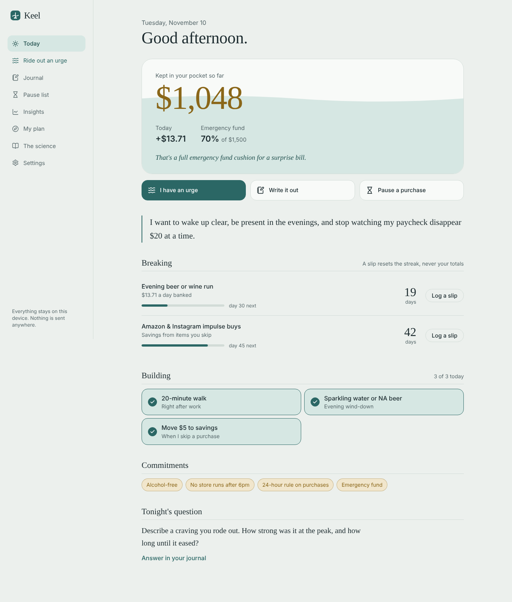
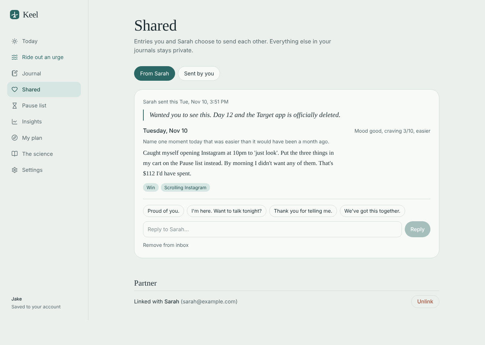
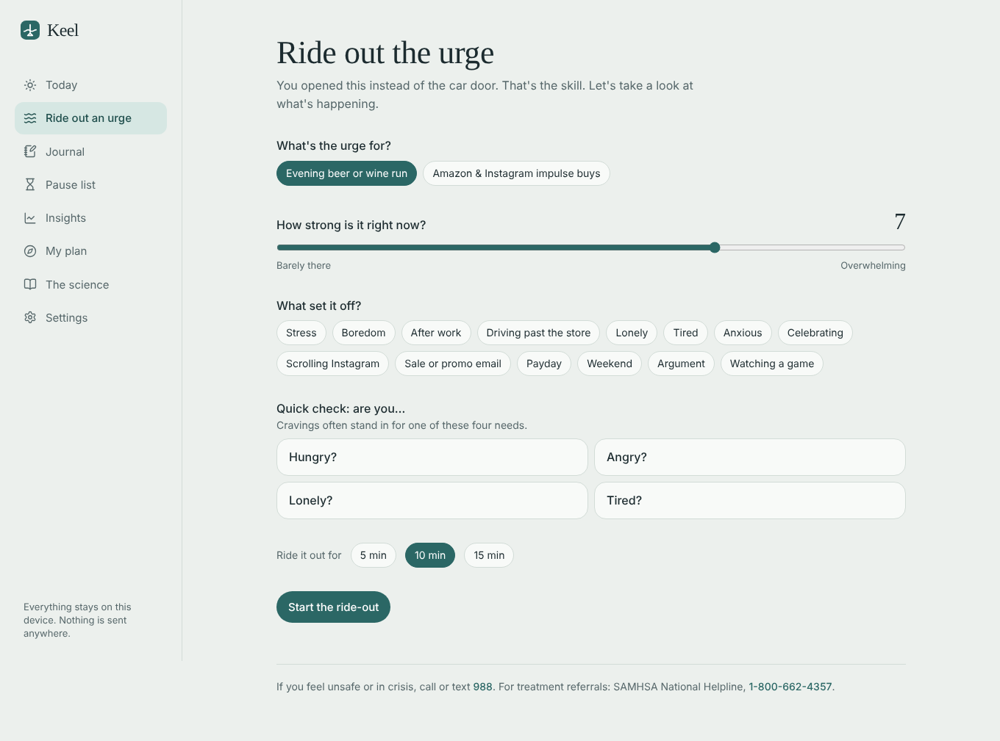
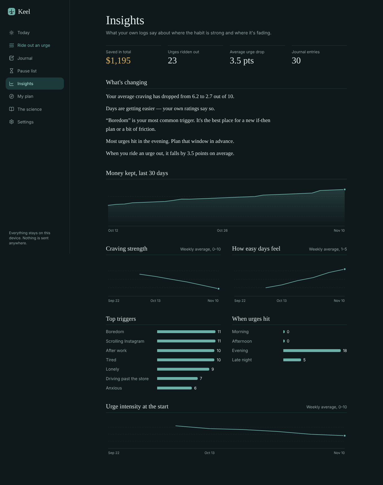

# Keel

**Break costly habits. Keep the difference.**

Keel is a private journal for cutting out drinking and impulse spending — the nightly run to the store for beer or wine, the late-night Amazon cart, the Instagram “add to bag.” It counts the money you keep, helps you ride out urges in the moment, turns triggers into if-then plans, and shows you week by week that it's getting easier.



## Features

| | |
|---|---|
| **Money kept** | Total and today's savings, drawn as a tide rising toward your savings goal. Routines (a $16 six-pack, 5×/week) bank a daily estimate; irregular buys only count when you log the item you skipped — real money, not a guess. |
| **Streaks & milestones** | Per-habit streaks with front-loaded milestones (1, 3, 7, 14, 30, 45, 66, 90 days). A slip resets the streak, never your totals or best run. |
| **Ride out an urge** | Rate the urge, tag the trigger, run a HALT check (hungry, angry, lonely, tired), then a guided 5/10/15-minute urge-surfing timer that shows your reason and your if-then plans. Rate it again after. |
| **Journal** | Daily CBT-style prompts, mood, craving strength, “how hard was today,” and trigger/win tags. Filter past entries by tag. |
| **Pause list** | Put a purchase on a 24/48/72-hour hold instead of buying. Skipped items count as savings; the list tracks your skip rate. |
| **Plan** | If-then plans, replacement habits (the new routine for the old moment), savings goal, your “why,” and commitment chips. |
| **Insights** | Savings over 30 days, weekly craving and ease trends, top triggers, when urges hit, average urge drop — plus a plain-language summary of what's changing. |
| **Reminders** | Evening check-in notification while the app is open or installed, plus a downloadable calendar file (daily check-in + a weekday 4:45pm “plan the drive home” alert) that works when the app is closed. |
| **The science** | Every feature is tied to a research finding, with citations. See [RESEARCH.md](RESEARCH.md). |
| **Separate accounts** | Each person signs in to their own private journal that syncs across their devices. |
| **Partner sharing** | Link with your partner, then send any journal entry with a note. They get it in their Shared inbox, can reply with a tap, and you see when it's been read. Unsend any time. Nothing is shared unless you send it. |
| **Private by design** | Row-level security in the database means one account can never read another's data. Or run with no backend at all in on-device mode. Export/import JSON backups. Light and dark themes. Installable as a PWA. |



<p>
  
  
</p>

## Stack

Next.js 15 (App Router), React 19, TypeScript, Tailwind CSS 4, Supabase (auth + Postgres with row-level security + realtime), lucide-react. The front end is fully static; Supabase is the only backend.

## Run locally

```bash
npm install
npm run dev        # http://localhost:3000
```

With no environment variables, Keel runs in single-person **on-device mode**. Choose **Explore with sample data** to see six weeks of realistic history.

## Accounts, sharing and deploying

**Follow [SETUP.md](SETUP.md)** — create a free Supabase project, run `supabase/schema.sql`, add two environment variables to Vercel, and deploy. Takes about 15 minutes.

## Project layout

```
app/            routes: / (Today), /urge, /journal, /shared, /pause, /insights, /plan, /learn, /settings, /more
components/     Shell (nav), Onboarding, TideCard, Charts, Modal, Reminders, ui primitives
lib/types.ts    data model
lib/calc.ts     savings, streaks, trends — all derived, nothing stored twice
lib/content.ts  triggers, prompts, commitments, science library, safety resources
lib/store.tsx   app state; syncs to your account (or the device), offline cache, sample data
lib/auth.tsx    sign-in session and profile
lib/sharing.tsx partner links, shared inbox, live updates
supabase/       schema.sql — tables, row-level security, sharing functions
```

## Roadmap ideas

- Web Push via a service worker for reminders when the app is closed
- Optional shared savings goal for the household
- Push notifications when your partner sends an entry
- Bank-transaction import (Plaid) to detect store and Amazon charges automatically
- Weekly review screen that prompts you to refresh stale if-then plans

## Important

Keel is a self-help journal, not medical treatment or financial advice. If you drink heavily or daily, stopping suddenly can cause withdrawal that may need medical care — talk to a doctor first. **SAMHSA National Helpline: 1-800-662-4357** (free, confidential, 24/7). In crisis, call or text **988**.

## License

MIT
